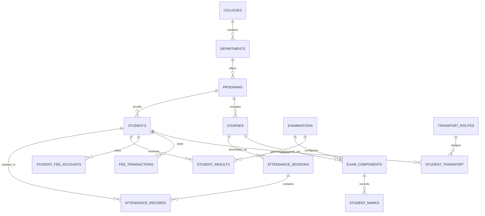

# DATABASE DESIGN: MARSHAL COLLEGE ERP SYSTEM

## 1. Architectural Strategy: Relational Core + Edge KV Caching
The MarshalERP database design supports dual deployment:
- **Relational Core (SQLite / Cloudflare D1 / PostgreSQL)**: Guarantees full ACID transactions for sensitive financial records, mark entry, attendance logs, and academic progression.
- **Edge Cache Layer (Cloudflare KV)**: Provides sub-10ms global edge delivery of student profile snapshots, published marksheets, attendance summaries, and active session tokens.

---

## 2. Table Schemas & Relational Specifications

### `colleges`
- `id` (VARCHAR(36) PRIMARY KEY)
- `code` (VARCHAR(20) UNIQUE)
- `name` (VARCHAR(150))
- `affiliation` (VARCHAR(150))
- `logo_url` (TEXT)
- `address` (TEXT)
- `phone` (VARCHAR(20))
- `email` (VARCHAR(100))

### `users`
- `id` (VARCHAR(36) PRIMARY KEY)
- `username` (VARCHAR(50) UNIQUE NOT NULL)
- `email` (VARCHAR(100) UNIQUE NOT NULL)
- `password_hash` (VARCHAR(255) NOT NULL)
- `display_name` (VARCHAR(100) NOT NULL)
- `role` (VARCHAR(30) NOT NULL) -- 'super_admin', 'principal', 'exam_controller', 'hod', 'faculty', 'accounts', 'transport'
- `department_id` (VARCHAR(36) REFERENCES departments(id))
- `avatar_url` (TEXT)
- `is_active` (BOOLEAN DEFAULT TRUE)
- `created_at` (TIMESTAMP DEFAULT CURRENT_TIMESTAMP)

### `departments`
- `id` (VARCHAR(36) PRIMARY KEY)
- `code` (VARCHAR(20) UNIQUE NOT NULL)
- `name` (VARCHAR(100) NOT NULL)
- `hod_id` (VARCHAR(36) REFERENCES users(id))

### `programs`
- `id` (VARCHAR(36) PRIMARY KEY)
- `department_id` (VARCHAR(36) REFERENCES departments(id))
- `code` (VARCHAR(20) UNIQUE NOT NULL)
- `name` (VARCHAR(100) NOT NULL)
- `degree` (VARCHAR(50)) -- 'B.Tech', 'M.Tech', 'B.Sc'
- `total_semesters` (INTEGER DEFAULT 8)

### `students`
- `id` (VARCHAR(36) PRIMARY KEY)
- `prn` (VARCHAR(30) UNIQUE NOT NULL) -- Permanent Registration Number
- `roll_no` (VARCHAR(20) NOT NULL)
- `seat_no` (VARCHAR(20))
- `name` (VARCHAR(100) NOT NULL)
- `email` (VARCHAR(100) UNIQUE NOT NULL)
- `password_hash` (VARCHAR(255) NOT NULL)
- `program_id` (VARCHAR(36) REFERENCES programs(id))
- `current_sem` (INTEGER NOT NULL)
- `division` (VARCHAR(5) NOT NULL)
- `batch` (VARCHAR(10))
- `academic_year` (VARCHAR(20) NOT NULL)
- `gender` (VARCHAR(10))
- `blood_group` (VARCHAR(5))
- `phone` (VARCHAR(20))
- `parent_phone` (VARCHAR(20))
- `address` (TEXT)
- `photo_url` (TEXT)
- `is_active` (BOOLEAN DEFAULT TRUE)
- `created_at` (TIMESTAMP DEFAULT CURRENT_TIMESTAMP)

### `courses`
- `id` (VARCHAR(36) PRIMARY KEY)
- `program_id` (VARCHAR(36) REFERENCES programs(id))
- `semester` (INTEGER NOT NULL)
- `code` (VARCHAR(20) NOT NULL)
- `name` (VARCHAR(100) NOT NULL)
- `credits` (DECIMAL(4,2) NOT NULL)
- `course_type` (VARCHAR(20) DEFAULT 'Theory') -- 'Theory', 'Practical', 'Project'
- `internal_max` (INTEGER DEFAULT 30)
- `external_max` (INTEGER DEFAULT 70)
- `total_max` (INTEGER DEFAULT 100)
- `passing_percentage` (DECIMAL(5,2) DEFAULT 40.0)

### `attendance_sessions`
- `id` (VARCHAR(36) PRIMARY KEY)
- `course_id` (VARCHAR(36) REFERENCES courses(id))
- `faculty_id` (VARCHAR(36) REFERENCES users(id))
- `semester` (INTEGER NOT NULL)
- `division` (VARCHAR(5) NOT NULL)
- `batch` (VARCHAR(10)) -- NULL for entire division
- `session_date` (DATE NOT NULL)
- `period_no` (INTEGER NOT NULL)
- `topic_delivered` (TEXT)
- `status` (VARCHAR(20) DEFAULT 'submitted')
- `created_at` (TIMESTAMP DEFAULT CURRENT_TIMESTAMP)

### `attendance_records`
- `id` (VARCHAR(36) PRIMARY KEY)
- `session_id` (VARCHAR(36) REFERENCES attendance_sessions(id) ON DELETE CASCADE)
- `student_id` (VARCHAR(36) REFERENCES students(id))
- `status` (VARCHAR(10) NOT NULL) -- 'Present', 'Absent', 'Late', 'Medical'
- `remarks` (TEXT)
- UNIQUE (`session_id`, `student_id`)

### `examinations`
- `id` (VARCHAR(36) PRIMARY KEY)
- `title` (VARCHAR(100) NOT NULL)
- `academic_year` (VARCHAR(20) NOT NULL)
- `semester` (INTEGER NOT NULL)
- `exam_type` (VARCHAR(20) NOT NULL) -- 'Regular', 'Backlog', 'In-Semester'
- `start_date` (DATE)
- `end_date` (DATE)
- `is_marks_entry_locked` (BOOLEAN DEFAULT FALSE)
- `is_published` (BOOLEAN DEFAULT FALSE)
- `published_at` (TIMESTAMP)

### `exam_components`
- `id` (VARCHAR(36) PRIMARY KEY)
- `exam_id` (VARCHAR(36) REFERENCES examinations(id) ON DELETE CASCADE)
- `course_id` (VARCHAR(36) REFERENCES courses(id))
- `component_name` (VARCHAR(50) NOT NULL) -- 'ISE' (In-Sem), 'ESE' (End-Sem), 'TW' (Term Work), 'PR' (Practical)
- `max_marks` (INTEGER NOT NULL)
- `passing_marks` (INTEGER NOT NULL)
- `weightage_percent` (INTEGER DEFAULT 100)

### `student_marks`
- `id` (VARCHAR(36) PRIMARY KEY)
- `component_id` (VARCHAR(36) REFERENCES exam_components(id))
- `student_id` (VARCHAR(36) REFERENCES students(id))
- `marks_obtained` (DECIMAL(5,2))
- `is_absent` (BOOLEAN DEFAULT FALSE)
- `entered_by` (VARCHAR(36) REFERENCES users(id))
- `updated_at` (TIMESTAMP DEFAULT CURRENT_TIMESTAMP)
- UNIQUE (`component_id`, `student_id`)

### `student_results`
- `id` (VARCHAR(36) PRIMARY KEY)
- `exam_id` (VARCHAR(36) REFERENCES examinations(id))
- `student_id` (VARCHAR(36) REFERENCES students(id))
- `total_credits` (DECIMAL(5,2) NOT NULL)
- `earned_credits` (DECIMAL(5,2) NOT NULL)
- `total_grade_points` (DECIMAL(6,2) NOT NULL)
- `sgpa` (DECIMAL(4,2) NOT NULL)
- `cgpa` (DECIMAL(4,2) NOT NULL)
- `result_status` (VARCHAR(20) NOT NULL) -- 'PASS', 'FAIL', 'ATKT', 'WITHHELD'
- `is_published` (BOOLEAN DEFAULT FALSE)
- `calculated_at` (TIMESTAMP DEFAULT CURRENT_TIMESTAMP)
- UNIQUE (`exam_id`, `student_id`)

### `fee_structures`
- `id` (VARCHAR(36) PRIMARY KEY)
- `program_id` (VARCHAR(36) REFERENCES programs(id))
- `academic_year` (VARCHAR(20) NOT NULL)
- `semester` (INTEGER NOT NULL)
- `fee_head` (VARCHAR(100) NOT NULL) -- 'Tuition Fee', 'Development Fee', 'Exam Fee', 'Library Deposit'
- `amount` (DECIMAL(10,2) NOT NULL)
- `due_date` (DATE NOT NULL)

### `student_fee_accounts`
- `id` (VARCHAR(36) PRIMARY KEY)
- `student_id` (VARCHAR(36) REFERENCES students(id))
- `academic_year` (VARCHAR(20) NOT NULL)
- `semester` (INTEGER NOT NULL)
- `total_assessed` (DECIMAL(10,2) NOT NULL)
- `concession` (DECIMAL(10,2) DEFAULT 0.00)
- `total_paid` (DECIMAL(10,2) DEFAULT 0.00)
- `balance` (DECIMAL(10,2) NOT NULL)
- `updated_at` (TIMESTAMP DEFAULT CURRENT_TIMESTAMP)
- UNIQUE (`student_id`, `academic_year`, `semester`)

### `fee_transactions`
- `id` (VARCHAR(36) PRIMARY KEY)
- `student_id` (VARCHAR(36) REFERENCES students(id))
- `receipt_no` (VARCHAR(50) UNIQUE NOT NULL)
- `amount` (DECIMAL(10,2) NOT NULL)
- `payment_mode` (VARCHAR(30) NOT NULL) -- 'Online', 'Cash', 'Cheque', 'Demand Draft', 'NEFT/RTGS'
- `transaction_ref` (VARCHAR(100))
- `paid_at` (TIMESTAMP DEFAULT CURRENT_TIMESTAMP)
- `received_by` (VARCHAR(36) REFERENCES users(id))
- `remarks` (TEXT)

### `transport_routes`
- `id` (VARCHAR(36) PRIMARY KEY)
- `route_name` (VARCHAR(100) NOT NULL)
- `vehicle_no` (VARCHAR(30) NOT NULL)
- `driver_name` (VARCHAR(100))
- `driver_phone` (VARCHAR(20))
- `annual_fee` (DECIMAL(10,2) NOT NULL)

### `transport_stops`
- `id` (VARCHAR(36) PRIMARY KEY)
- `route_id` (VARCHAR(36) REFERENCES transport_routes(id))
- `stop_name` (VARCHAR(100) NOT NULL)
- `pickup_time` (VARCHAR(20) NOT NULL)
- `drop_time` (VARCHAR(20) NOT NULL)
- `stop_order` (INTEGER DEFAULT 1)

### `student_transport`
- `id` (VARCHAR(36) PRIMARY KEY)
- `student_id` (VARCHAR(36) REFERENCES students(id) UNIQUE)
- `route_id` (VARCHAR(36) REFERENCES transport_routes(id))
- `stop_id` (VARCHAR(36) REFERENCES transport_stops(id))
- `bus_pass_no` (VARCHAR(30) UNIQUE NOT NULL)
- `academic_year` (VARCHAR(20) NOT NULL)
- `status` (VARCHAR(20) DEFAULT 'Active')

### `timetables`
- `id` (VARCHAR(36) PRIMARY KEY)
- `program_id` (VARCHAR(36) REFERENCES programs(id))
- `semester` (INTEGER NOT NULL)
- `division` (VARCHAR(5) NOT NULL)
- `day_of_week` (VARCHAR(15) NOT NULL) -- 'Monday', 'Tuesday', ...
- `period_no` (INTEGER NOT NULL)
- `start_time` (VARCHAR(10) NOT NULL)
- `end_time` (VARCHAR(10) NOT NULL)
- `course_id` (VARCHAR(36) REFERENCES courses(id))
- `faculty_id` (VARCHAR(36) REFERENCES users(id))
- `room_no` (VARCHAR(30) NOT NULL)

### `notices`
- `id` (VARCHAR(36) PRIMARY KEY)
- `title` (VARCHAR(200) NOT NULL)
- `category` (VARCHAR(50) NOT NULL) -- 'Academic', 'Examination', 'Fees', 'Sports', 'General'
- `content` (TEXT NOT NULL)
- `target_role` (VARCHAR(30) DEFAULT 'all') -- 'all', 'students', 'staff'
- `attachment_url` (TEXT)
- `created_by` (VARCHAR(36) REFERENCES users(id))
- `created_at` (TIMESTAMP DEFAULT CURRENT_TIMESTAMP)

### `grievances`
- `id` (VARCHAR(36) PRIMARY KEY)
- `student_id` (VARCHAR(36) REFERENCES students(id))
- `ticket_no` (VARCHAR(30) UNIQUE NOT NULL)
- `category` (VARCHAR(50) NOT NULL) -- 'Academic', 'Examination', 'Fees', 'Hostel', 'Transport'
- `subject` (VARCHAR(200) NOT NULL)
- `description` (TEXT NOT NULL)
- `status` (VARCHAR(20) DEFAULT 'Open') -- 'Open', 'In_Progress', 'Resolved'
- `resolution` (TEXT)
- `resolved_by` (VARCHAR(36) REFERENCES users(id))
- `created_at` (TIMESTAMP DEFAULT CURRENT_TIMESTAMP)
- `resolved_at` (TIMESTAMP)

### `audit_logs`
- `id` (VARCHAR(36) PRIMARY KEY)
- `user_type` (VARCHAR(20) NOT NULL) -- 'staff', 'student'
- `user_id` (VARCHAR(36) NOT NULL)
- `action` (VARCHAR(50) NOT NULL) -- 'LOGIN', 'MARK_ATTENDANCE', 'ENTER_MARKS', 'PUBLISH_RESULTS', 'RECORD_PAYMENT'
- `entity_type` (VARCHAR(50))
- `entity_id` (VARCHAR(36))
- `payload` (TEXT)
- `ip_address` (VARCHAR(50))
- `created_at` (TIMESTAMP DEFAULT CURRENT_TIMESTAMP)

---

## 3. Cloudflare KV Key Specification
For high-speed edge distribution:
- `kv:session:<token>`: Active user session claims.
- `kv:student:profile:<student_id>`: Serialized student profile JSON.
- `kv:student:attendance:<student_id>:<sem>`: Subject-wise attendance calculation cache.
- `kv:student:gradecard:<student_id>:<exam_id>`: Official published gradecard snapshot.
- `kv:live:viewers:<exam_id>`: Set of student IDs currently viewing the live marksheet.
