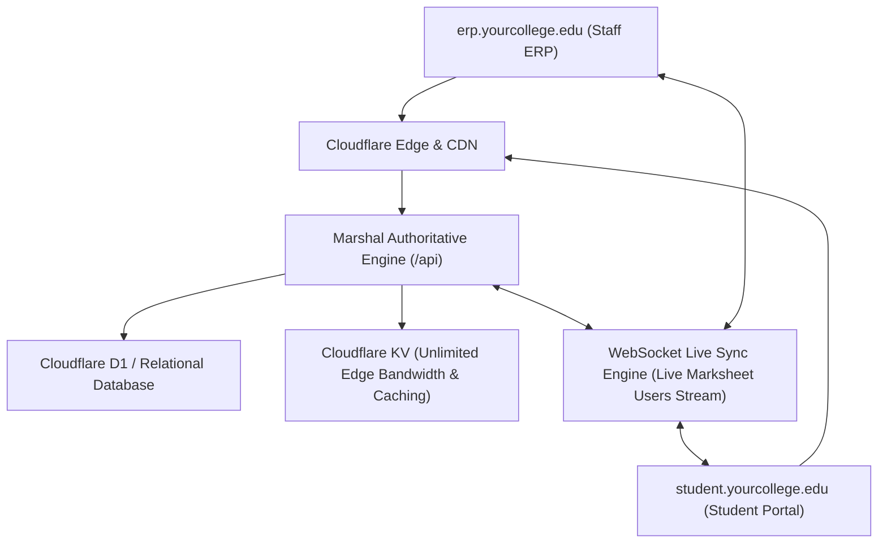

# DEPLOYMENT GUIDE: MARSHAL COLLEGE ERP & DUAL PORTAL SYSTEM

## 1. Architecture Overview: How the 2 Connected Sites Operate

To achieve your vision of **2 distinct sites** (Site 1: Staff ERP and Site 2: Student/Learner Portal) controlled from one central authoritative engine:



### Hosting Options:
- **Option A (Subdomain Architecture - Recommended)**:
  - `erp.yourcollege.edu` $\rightarrow$ Directs to Staff ERP view.
  - `student.yourcollege.edu` $\rightarrow$ Directs to Learner Portal view.
  - Both talk to `https://api.yourcollege.edu` (or `/api`).
- **Option B (Path-Based on Single Domain)**:
  - `yourcollege.edu/staff` $\rightarrow$ Staff ERP.
  - `yourcollege.edu/learner` $\rightarrow$ Student Portal.
  - Root `/` $\rightarrow$ Portal Selection Hub.

---

## 2. Cloudflare D1 & KV Setup Guide

### Step 1: Create Cloudflare D1 Database
```bash
# Install Wrangler CLI globally or locally
npm install -g wrangler

# Login to Cloudflare
wrangler login

# Create D1 Database
wrangler d1 create marshal-erp-db
```
Copy the generated `database_id` into `cloudflare/wrangler.toml` and `.env`.

### Step 2: Initialize D1 Schema
```bash
wrangler d1 execute marshal-erp-db --file=./server/db/schema.sql
```

### Step 3: Create Cloudflare KV Namespace (Unlimited Bandwidth Edge Cache)
```bash
wrangler kv namespace create KV_CACHE
```
Copy the generated `id` into `cloudflare/wrangler.toml`. Cloudflare KV caches published student marksheets, session tokens, and profiles so thousands of students opening marksheets simultaneously incur zero latency and unlimited bandwidth!

---

## 3. Local Installation & Development Running

### 1. Prerequisites
- Node.js >= 18.0.0
- Git

### 2. Install & Seed Server
```bash
cd server
npm install
npm run seed       # Populates complete college, faculty, courses, Darshan Dalvi (121B1G148), exam, and fees
npm run test       # Executes verified test suite
npm run dev        # Starts server on http://localhost:5000 and ws://localhost:5000/api/ws/live
```

### 3. Install & Run Client (Dual-Portal)
```bash
cd client
npm install
npm run dev        # Starts client on http://localhost:5173
```
Visit `http://localhost:5173` in your browser.

---

## 4. Testing the Live Marksheet Synchronizer
1. Open `http://localhost:5173/staff/live-monitor` in one window (Staff ERP).
2. Open `http://localhost:5173/learner/gradecard` in another window or incognito (Student Portal logged in as Darshan Dalvi, PRN `121B1G148`).
3. Notice how the Staff Live Monitor **instantly displays**:
   *`"1 Active Learner: Darshan Dalvi (PRN: 121B1G148) viewing End Semester Autonomous Examination Marksheet"`* with a live green indicator!
4. When the Exam Controller clicks **Publish Marksheet** on the Staff ERP, the student's Grade Card refreshes immediately in real time.
