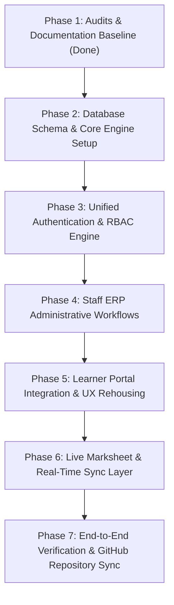

# MARSHAL COLLEGE ERP & LEARNER PORTAL - IMPLEMENTATION PLAN

## 1. System Vision & Architecture
MarshalERP integrates the Staff/College Administration ERP (`pceterpin`) and the Student/Learner Web Portal (`student rp`) into a unified, high-performance, secure College ERP platform.

### Two Connected Portals, One Authoritative Engine:
1. **Staff ERP Portal** (`/staff` / Port 5173 or `/`):
   - Designed for Super Admin, Principal, Examination Controller, HOD, Faculty, Accounts/Fee Admin, and Transport Incharge.
   - Administrative dashboards, lecture-wise attendance entry, exam mark entry, gradecard publication, fee collection, and real-time student monitoring.
2. **Learner / Student Portal** (`/learner` / Port 5174 or `/student`):
   - Dedicated, student-centric portal reusing the layout, components, and aesthetic conventions of `student rp`.
   - Access to daily attendance percentages, published official marksheets with SGPA/CGPA, downloadable hall tickets, fee dues & receipts, transport route info, and grievances.
3. **Authoritative Backend & Database Server** (`server/` / Port 5000):
   - Node.js / Express REST API + WebSocket real-time synchronization layer.
   - Robust relational database schema (SQLite / Cloudflare D1 compatible + Cloudflare KV caching layer for unlimited edge bandwidth).
   - Strict server-side RBAC and Object-Level Access Control (OLAC).

---

## 2. Phased Implementation Roadmap

### Detailed Phase Milestones:
- **Phase 1: Architecture & Inventory Documentation**: Completed audits of both `pceterpin` and `student rp`.
- **Phase 2: Database Design & Service Foundation**:
  - Implement SQLite/D1 database schema with foreign keys, constraints, triggers, and full seed data representing an active college (departments, programs, faculty, courses, students, attendance, exams, marks, fees, transport).
  - Setup Cloudflare KV adapter / cache layer for edge deployment.
- **Phase 3: Authentication & Security**:
  - Unified JWT issuance supporting both Staff (role-based) and Student (PRN-bound).
  - Authorization middleware verifying student ownership of queried records.
- **Phase 4: Staff ERP Portal Implementation**:
  - Staff Dashboard with metrics, live learner monitor, and quick actions.
  - Academic & Attendance module: Lecture creation, bulk student marking, percentage calculation.
  - Examination & Marks Entry module: Assessment creation, faculty mark entry, SGPA/CGPA calculation engine, and result publication workflow.
  - Fee Management: Payment collection, fee concession, receipt generation.
  - Transport Management: Route & bus pass management.
- **Phase 5: Learner Portal Implementation**:
  - Responsive Student Dashboard.
  - My Attendance view with subject breakdown and progress charts.
  - My Grade Card / Live Marksheet with watermark, barcode, subject credits, letter grades, SGPA, and cumulative CGPA.
  - Fee payment history & downloadable 3-copy receipts.
  - Examination Hall Ticket view.
- **Phase 6: Real-Time Synchronization**:
  - WebSocket hub broadcasting marksheet publishing and attendance updates.
  - Live Marksheet Activity Monitor on Staff ERP displaying current active student viewers.
- **Phase 7: QA Testing, Git Configuration & Push**:
  - Run comprehensive test suite.
  - Initialize git repository in `MarshalERP`, commit all files, configure GitHub remote with the user's personal access token, and push to `https://github.com/darshanXtobi/MarshalERP.git`.
