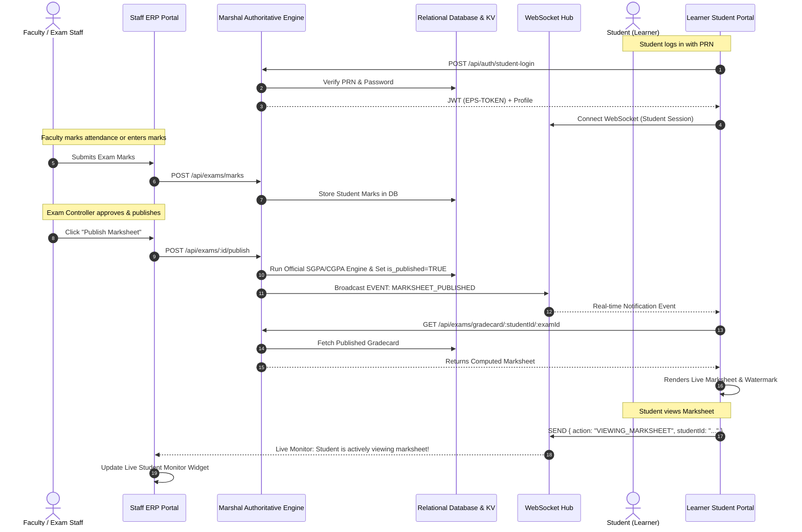

# LEARNER & STAFF ERP INTEGRATION ARCHITECTURE

## 1. Integration Paradigm
MarshalERP connects the Staff-Facing ERP (`pceterpin`) and the Student-Facing Learner Portal (`student rp`) into one reactive, single-source-of-truth ecosystem.

---

## 2. Shared Data Entities & Consistency Rules

### 1. Consistent Student Identity
- Single primary key `students.id` (UUID) paired with `prn` (Permanent Registration Number) and `roll_no`.
- Staff ERP searches students by PRN/Roll No/Name; Learner Portal identifies authenticated student directly from token claims.

### 2. Live Marksheet Synchronization
- **Draft State**: While faculty is entering or adjusting marks, `is_published = FALSE`. The student portal shows:
  *"Assessment evaluated. Awaiting official Controller publication."*
- **Publication State**: When Exam Controller clicks **Publish**, the backend calculates:
  - Subject Totals, Letter Grades, Grade Points.
  - Credit Points ($C_i \times G_i$).
  - Semester SGPA and cumulative CGPA.
  - Sets `is_published = TRUE` and invalidates KV cache.
  - Pushes an immediate WebSocket broadcast. The student portal refreshes instantly.

### 3. Live Active Student / Marksheet Monitor
- When students navigate to `/examinations/gradecard`, the student portal registers a heartbeat with the WebSocket hub.
- The Staff ERP's **Live Monitor** dashboard widget displays:
  - Number of students currently online.
  - List of students actively inspecting their marksheets in real time.
  - Timestamp of student access and IP/device metadata.

### 4. Attendance Synchronization
- When faculty marks a session, total lectures conducted and attended increment immediately.
- The learner portal's attendance percentage gauge updates instantly upon subsequent query or push event.

### 5. Financial Reconciliation
- Accounts staff enters a payment (Cash/Online/Cheque) $\rightarrow$ updates `student_fee_accounts.total_paid` and `balance` atomically inside a database transaction.
- Learner portal shows zero discrepancy between staff accounts balance and student dues.
